

<picture>
  <source media="(max-width: 768px)" srcset="assets/hero-mobile.svg">
  
</picture>

 

<picture>
  <source media="(max-width: 768px)" srcset="assets/terminal-mobile.svg">
  
</picture>

## About

I'm Cristiano Vieira, a Brazilian software engineer. I design and build mobile applications, web platforms, and the services behind them.

The work runs the full length of a product: experience, client applications, APIs, integrations, and architecture. I care about systems that stay clear as they grow, and about software that holds up once people are using it.

I founded and develop **[Jobtto](https://jobtto.com)**, a marketplace for hiring services and freelancers. I build **Orderflow**, an operating system for restaurants covering point of sale, delivery, and day-to-day operations. With **[Gaúcho Tech](https://gauchotech.com.br)**, I deliver applications, websites, and business systems.

I'm available for new opportunities.


## My Tech Universe

The surfaces I use to design, build, and ship.

<picture>
  <source media="(max-width: 768px)" srcset="assets/tech-universe-compact.svg">
  
</picture>

 

**Mobile engineering** — React Native, Expo, Android, iOS

**Frontend engineering** — React, Next.js, Angular, TypeScript

**Backend and cloud** — Node.js, Firebase, REST APIs

**Tools and engineering** — Git, GitHub, VS Code, Xcode, Android Studio

  
  
  
  
  
  
  
  

  
  
  
  
  
  
  
  

## Featured projects

Selected products I founded, built, or ship.


**Jobtto** · Marketplace

A marketplace for hiring services and freelancers. I founded it and build the product.

[jobtto.com](https://jobtto.com)


**Orderflow** · Operations

Restaurant management for point of sale, delivery, and daily operations.


**Gaúcho Tech** · Studio

Applications, websites, and business systems.

[gauchotech.com.br](https://gauchotech.com.br)


**Portfolio** · Selected work

A personal archive of mobile and web projects.

[cristianovieira1.github.io/portfolio](https://cristianovieira1.github.io/portfolio/)

## Developer intelligence

Public GitHub activity only. Client work and private repositories are not included.

The language chart counts bytes GitHub detects in public repositories. Project scaffolding can outweigh the TypeScript, React, and React Native code behind current products. The stack I ship with is the one in My Tech Universe.

<picture>
  <source media="(max-width: 768px)" srcset="assets/activity-metrics-mobile.svg">
  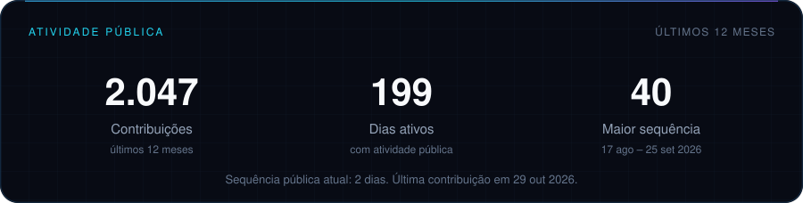
</picture>

<!-- activity:start -->

2,042 public contributions in the last 12 months · 197 active days · longest streak 40 days (Aug 17, 2026 – Sep 25, 2026) · current streak 0 days · latest contribution Oct 21, 2026

<!-- activity:end -->

<picture>
  <source media="(max-width: 768px)" srcset="assets/languages-mobile.svg">
  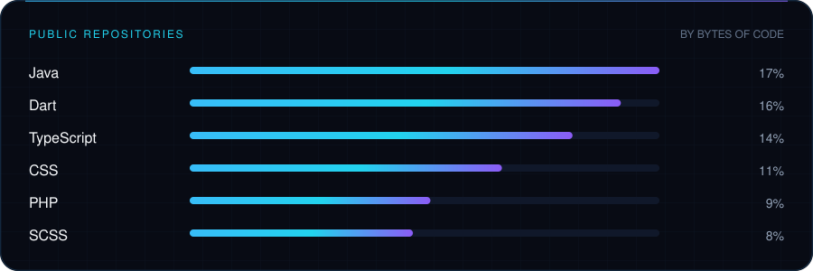
</picture>

<!-- languages:start -->

Language share in public repositories, by bytes: Java 17% · Dart 16% · TypeScript 14% · CSS 11% · PHP 9% · SCSS 8%

<!-- languages:end -->

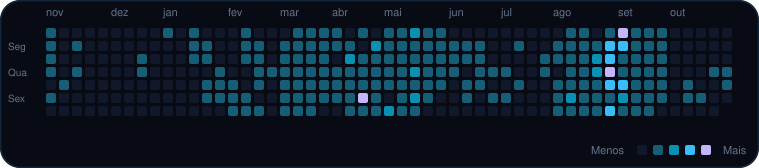

<!--
  Snake animation
  Run the "Generate contribution snake" workflow once. It commits assets/snake.svg.
  Then uncomment the block below.

  

-->

<h2>Let's turn ambitious ideas into powerful digital products.</h2>

&nbsp;&nbsp;

&nbsp;&nbsp;

&nbsp;&nbsp;

 

<picture>
  <source media="(max-width: 768px)" srcset="assets/footer-mobile.svg">
  
</picture>

