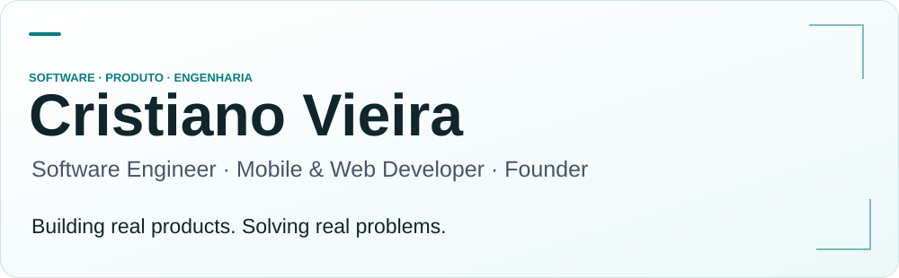
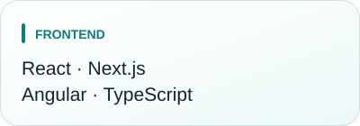
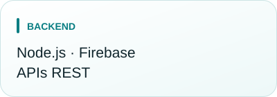
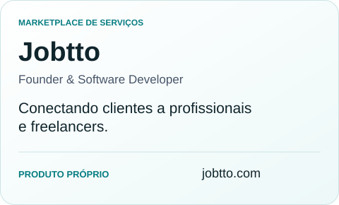
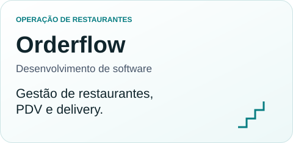
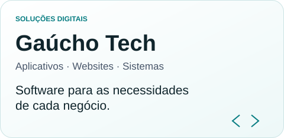
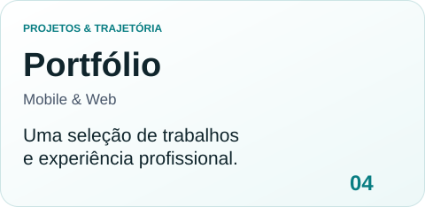
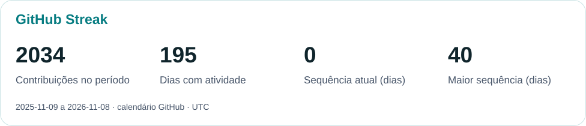
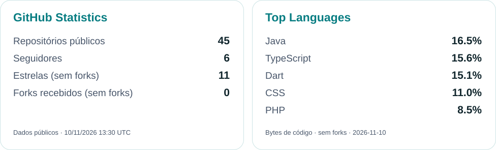

# Cristiano Vieira

<picture>
  <source media="(max-width: 600px) and (prefers-color-scheme: dark)" srcset="assets/hero-dark-mobile.svg">
  <source media="(max-width: 600px)" srcset="assets/hero-light-mobile.svg">
  <source media="(prefers-color-scheme: dark)" srcset="assets/hero-dark.svg">
  
</picture>

Sou engenheiro de software, desenvolvedor de aplicações mobile e web e fundador do **[Jobtto](https://jobtto.com)**. Trabalho no desenvolvimento de produtos digitais, da arquitetura e dos serviços de backend às interfaces e experiências mobile.

## Tecnologias e especialidades

<picture>
  <source media="(prefers-color-scheme: dark)" srcset="assets/stack/mobile-dark.svg">
  
</picture>
<picture>
  <source media="(prefers-color-scheme: dark)" srcset="assets/stack/frontend-dark.svg">
  
</picture>
<picture>
  <source media="(prefers-color-scheme: dark)" srcset="assets/stack/backend-dark.svg">
  
</picture>
<picture>
  <source media="(prefers-color-scheme: dark)" srcset="assets/stack/tools-dark.svg">
  
</picture>

## Produtos e projetos

<!-- Cards com largura natural: quebram de linha em telas estreitas. Links ficam fora do SVG. -->

<a href="https://jobtto.com" aria-label="Conhecer jobtto">
<picture>
  <source media="(prefers-color-scheme: dark)" srcset="assets/projects/jobtto-dark.svg">
  
</picture>
</a>
<picture>
  <source media="(prefers-color-scheme: dark)" srcset="assets/projects/orderflow-dark.svg">
  
</picture>
<a href="https://gauchotech.com.br" aria-label="Conhecer gauchotech">
<picture>
  <source media="(prefers-color-scheme: dark)" srcset="assets/projects/gauchotech-dark.svg">
  
</picture>
</a>
<a href="https://cristianovieira1.github.io/portfolio/" aria-label="Conhecer portfolio">
<picture>
  <source media="(prefers-color-scheme: dark)" srcset="assets/projects/portfolio-dark.svg">
  
</picture>
</a>

## GitHub em perspectiva

Os cards mostram dados disponibilizados pelo GitHub. Repositórios públicos, contribuições e linguagens são recortes da atividade e não representam toda a minha experiência ou o trabalho em projetos privados.

<picture>
  <source media="(max-width: 600px) and (prefers-color-scheme: dark)" srcset="assets/stats/streak-mobile-dark.svg">
  <source media="(max-width: 600px)" srcset="assets/stats/streak-mobile-light.svg">
  <source media="(prefers-color-scheme: dark)" srcset="assets/stats/streak-dark.svg">
  
</picture>

<picture>
  <source media="(max-width: 600px) and (prefers-color-scheme: dark)" srcset="assets/stats/overview-mobile-dark.svg">
  <source media="(max-width: 600px)" srcset="assets/stats/overview-mobile-light.svg">
  <source media="(prefers-color-scheme: dark)" srcset="assets/stats/overview-dark.svg">
  
</picture>

[Consultar atividade no GitHub](https://github.com/CristianoVieira1?tab=overview) · [Como os dados são atualizados](docs/PROFILE.md)

## Contribuições em movimento

<picture>
  <source media="(prefers-reduced-motion: reduce) and (prefers-color-scheme: dark)" srcset="assets/snake-static-dark.svg">
  <source media="(prefers-reduced-motion: reduce)" srcset="assets/snake-static-light.svg">
  <source media="(prefers-color-scheme: dark)" srcset="assets/snake-dark.svg">
  
</picture>

## Vamos conversar

Estou disponível para novas oportunidades e conversas sobre desenvolvimento de produtos.

<a href="https://cristianovieira1.github.io/portfolio/">
<picture>
  <source media="(prefers-color-scheme: dark)" srcset="assets/social/portfolio-dark.svg">
  
</picture>
</a>
<a href="https://www.linkedin.com/in/cristianobv/">
<picture>
  <source media="(prefers-color-scheme: dark)" srcset="assets/social/linkedin-dark.svg">
  
</picture>
</a>
<a href="https://github.com/CristianoVieira1">
<picture>
  <source media="(prefers-color-scheme: dark)" srcset="assets/social/github-dark.svg">
  
</picture>
</a>
<a href="mailto:cristianovieirati@gmail.com">
<picture>
  <source media="(prefers-color-scheme: dark)" srcset="assets/social/email-dark.svg">
  
</picture>
</a>
<a href="https://api.whatsapp.com/send?phone=51998884446">
<picture>
  <source media="(prefers-color-scheme: dark)" srcset="assets/social/whatsapp-dark.svg">
  
</picture>
</a>

[cristianovieirati@gmail.com](mailto:cristianovieirati@gmail.com) · [Site pessoal](https://cristianoborges.dev/)
